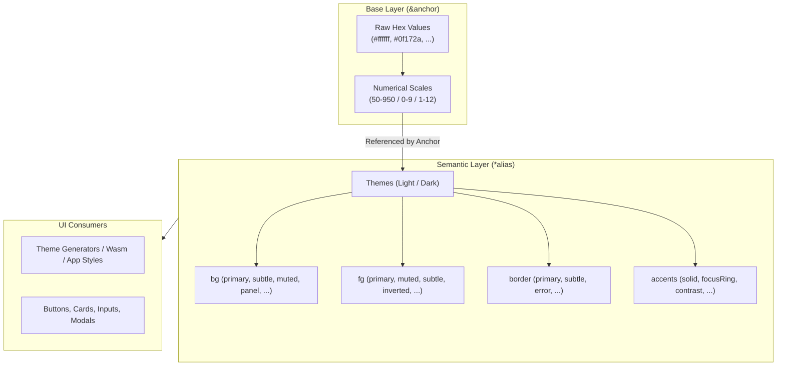

# 🎨 Open Source Color Palettes

A curated collection of production-grade color palettes extracted and
standardized from leading open-source design systems and UI frameworks. Each
palette is structured in standard hexadecimal formats (YAML and JSON), featuring
unified semantic token mappings for light and dark themes via YAML anchors.

## 🚀 Overview

Design systems establish predictable, accessible visual hierarchies using
numerical color scales and semantic aliases. This repository organizes color
definitions from:

- **[Chakra UI](https://chakra-ui.com/) (v3)** – Balanced scales with semantic
  component states and neutral dark bases.
- **[Open Color](https://yeun.github.io/open-color/)** – Clean, vibrant 10-step
  UI color scales optimized for standard interfaces.
- **[Radix Colors](https://www.radix-ui.com/colors)** – Accessible 12-step
  scales tailored for specific UI roles (backgrounds, borders, solids, text)
  across light and dark modes.
- **[Tailwind CSS](https://tailwindcss.com/)** – Extensive 11-step scales
  covering multiple gray families and rich accent hues.

## 📁 Directory Structure

```plaintext
~/.config/colors/
├── chakra/
│   └── v3/
│       ├── chakra.v3.colors.json   # Flat hex tokens in JSON format
│       └── chakra.v3.colors.yaml   # Base colors and light/dark semantic tokens
├── opencolor/
│   ├── opencolor.json              # Array-based 10-step color scales
│   └── opencolor.yaml              # Keyed swatches and semantic token mappings
├── radix/
│   └── radix.yaml                  # 12-step functional light/dark scales & semantic tokens
└── tailwind/
    └── tailwind.yaml               # 50–950 color steps and light/dark semantic tokens
```

## 🏗️ Token Architecture

All YAML definitions follow a two-tier token hierarchy powered by native **YAML
anchors (`&`)** and **aliases (`*`)**. Changing a base color definition
automatically updates all dependent semantic tokens without duplication.



### Unified Semantic Token Keys

Each palette standardizes on the following core semantic tokens:

| Token Group | Keys                                                                                                           | Purpose                                                    |
| ----------- | -------------------------------------------------------------------------------------------------------------- | ---------------------------------------------------------- |
| `bg`        | `primary`, `subtle`, `muted`, `emphasized`, `inverted`, `panel`, `error`, `warning`, `success`, `info`, `hint` | Background fills, surfaces, cards, and notification panels |
| `fg`        | `primary`, `muted`, `subtle`, `inverted`, `error`, `warning`, `success`, `info`, `hint`                        | Text, icons, and foreground indicators                     |
| `border`    | `primary`, `muted`, `subtle`, `emphasized`, `inverted`, `error`, `warning`, `success`, `info`, `hint`          | Element outlines, dividers, and card borders               |
| `[hue]`     | `contrast`, `fg`, `subtle`, `muted`, `emphasized`, `solid`, `focusRing`, `border`                              | Component-level token suites for interactive accents       |

## 🎨 Included Palettes

### ⚡ Chakra UI (v3)

- **Original Project**: [Website](https://chakra-ui.com/) ·
  [GitHub](https://github.com/chakra-ui/chakra-ui) ·
  [Color Tokens Guide](https://chakra-ui.com/docs/theming/colors)
- **Path**: `chakra/v3/chakra.v3.colors.yaml` & `chakra.v3.colors.json`
- **Scale**: `50`, `100`, `200`, `300`, `400`, `500`, `600`, `700`, `800`,
  `900`, `950`
- **Neutral Base**: Black is configured as `#09090b` (zinc-tinted dark base).
- **Hues**: `gray`, `red`, `orange`, `yellow`, `green`, `teal`, `blue`, `cyan`,
  `purple`, `pink`.

### 🌈 Open Color

- **Original Project**: [Website](https://yeun.github.io/open-color/) ·
  [GitHub](https://github.com/yeun/open-color) ·
  [Color Specification](https://yeun.github.io/open-color/)
- **Path**: `opencolor/opencolor.yaml` & `opencolor.json`
- **Scale**: `0` through `9` (10 steps)
- **Hues**: `gray`, `red`, `pink`, `grape`, `violet`, `indigo`, `blue`, `cyan`,
  `teal`, `green`, `lime`, `yellow`, `orange`.
- **JSON Structure**: Array-indexed hex values for direct index lookup
  (`opencolor.json`).

### 📐 Radix Colors

- **Original Project**: [Website & Playground](https://www.radix-ui.com/colors)
  · [GitHub](https://github.com/radix-ui/colors) ·
  [12-Step Scale Guide](https://www.radix-ui.com/colors/docs/palette-composition/understanding-the-scale)
- **Path**: `radix/radix.yaml`
- **Scale**: `1` through `12` (12-step functional scale)
- **Roles per Step**:
  - `1–2`: App and page backgrounds (subtle canvas)
  - `3–5`: Component backgrounds (interactive / hover / active)
  - `6–8`: Borders and subtle accents
  - `9–10`: Solid brand / primary action backgrounds
  - `11–12`: Accessible foreground text (low-contrast secondary & high-contrast
    primary)
- **Hues**: 30+ light and dark color scales including `slate`, `mauve`, `olive`,
  `sage`, `sand`, `bronze`, `gold`, `iris`, `ruby`, `jade`, `mint`, `sky`,
  `amber`, `tomato`, and more.

### 🌊 Tailwind CSS

- **Original Project**: [Website](https://tailwindcss.com/) ·
  [GitHub](https://github.com/tailwindlabs/tailwindcss) ·
  [Default Colors Reference](https://tailwindcss.com/docs/customizing-colors)
- **Path**: `tailwind/tailwind.yaml`
- **Scale**: `50`, `100`, `200`, `300`, `400`, `500`, `600`, `700`, `800`,
  `900`, `950`
- **Gray Variations**: 5 dedicated gray families (`slate`, `gray`, `zinc`,
  `neutral`, `stone`).
- **Accent Hues**: `red`, `orange`, `amber`, `yellow`, `lime`, `green`,
  `emerald`, `teal`, `cyan`, `sky`, `blue`, `indigo`, `violet`, `purple`,
  `fuchsia`, `pink`, `rose`.

## 📊 Comparison Matrix

| Palette          | Steps         | Light / Dark Scale Definition        | Semantic Tokens   | Formats    | Primary Strength                    |
| ---------------- | ------------- | ------------------------------------ | ----------------- | ---------- | ----------------------------------- |
| **Chakra UI v3** | 11 (`50-950`) | Single scale + dark semantic aliases | ✅ (Light & Dark) | YAML, JSON | Modern component token ergonomics   |
| **Open Color**   | 10 (`0-9`)    | Single scale + semantic aliases      | ✅ (Light & Dark) | YAML, JSON | Compact, simple 10-step indexing    |
| **Radix Colors** | 12 (`1-12`)   | Independent light and dark scales    | ✅ (Light & Dark) | YAML       | Contrast-tested functional UI roles |
| **Tailwind CSS** | 11 (`50-950`) | Single scale + semantic aliases      | ✅ (Light & Dark) | YAML       | Broadest variety of hues and grays  |

## 🛠️ Usage & Integration

### CLI / Shell with `yq`

Query base colors or resolved semantic tokens directly from the terminal:

```bash
# Query Tailwind slate-500
yq '.colors.slate.500' ~/.config/colors/tailwind/tailwind.yaml

# Query Radix light primary background
yq '.semantic.light.bg.primary' ~/.config/colors/radix/radix.yaml

# Query Chakra v3 dark mode surface panel
yq '.semantic.dark.bg.panel' ~/.config/colors/chakra/v3/chakra.v3.colors.yaml
```

### Python (`PyYAML`)

```python
import yaml
from pathlib import Path

config_path = Path.home() / ".config/colors/tailwind/tailwind.yaml"

with open(config_path, "r", encoding="utf-8") as f:
    # PyYAML automatically resolves anchors and aliases
    palette = yaml.safe_load(f)

# Access base swatch
print("Slate 500:", palette["colors"]["slate"][500])

# Access semantic token
print("Dark primary background:", palette["semantic"]["dark"]["bg"]["primary"])
```

### Node.js (`yaml`)

```javascript
import { readFileSync } from "node:fs";
import { homedir } from "node:os";
import { join } from "node:path";
import YAML from "yaml";

const file = readFileSync(
  join(homedir(), ".config/colors/radix/radix.yaml"),
  "utf8",
);

// Parsed document automatically resolves anchor references
const tokens = YAML.parse(file);

console.log("Light BG Panel:", tokens.semantic.light.bg.panel);
console.log("Dark Solid Blue:", tokens.semantic.dark.blue.solid);
```

> [!TIP]
> When parsing the YAML files, ensure your YAML loader resolves anchors and
> aliases (such as `safe_load` in Python or `YAML.parse` in JS/TS) so semantic
> tokens resolve directly to their hexadecimal strings.

> [!NOTE]
> The JSON files (`chakra.v3.colors.json` and `opencolor.json`) provide
> flattened representations without anchors for environments that prefer
> standard JSON.

## 🔗 References & Original Projects

| Project            | Official Website                                                | GitHub Repository                                                       | Color Documentation / Spec                                                                                    | License |
| ------------------ | --------------------------------------------------------------- | ----------------------------------------------------------------------- | ------------------------------------------------------------------------------------------------------------- | ------- |
| **Chakra UI (v3)** | [chakra-ui.com](https://chakra-ui.com/)                         | [chakra-ui/chakra-ui](https://github.com/chakra-ui/chakra-ui)           | [Chakra Theming & Colors](https://chakra-ui.com/docs/theming/colors)                                          | MIT     |
| **Open Color**     | [yeun.github.io/open-color](https://yeun.github.io/open-color/) | [yeun/open-color](https://github.com/yeun/open-color)                   | [Open Color Spec](https://yeun.github.io/open-color/)                                                         | MIT     |
| **Radix Colors**   | [radix-ui.com/colors](https://www.radix-ui.com/colors)          | [radix-ui/colors](https://github.com/radix-ui/colors)                   | [12-Step Scale Composition](https://www.radix-ui.com/colors/docs/palette-composition/understanding-the-scale) | MIT     |
| **Tailwind CSS**   | [tailwindcss.com](https://tailwindcss.com/)                     | [tailwindlabs/tailwindcss](https://github.com/tailwindlabs/tailwindcss) | [Tailwind Color Palette Reference](https://tailwindcss.com/docs/customizing-colors)                           | MIT     |
